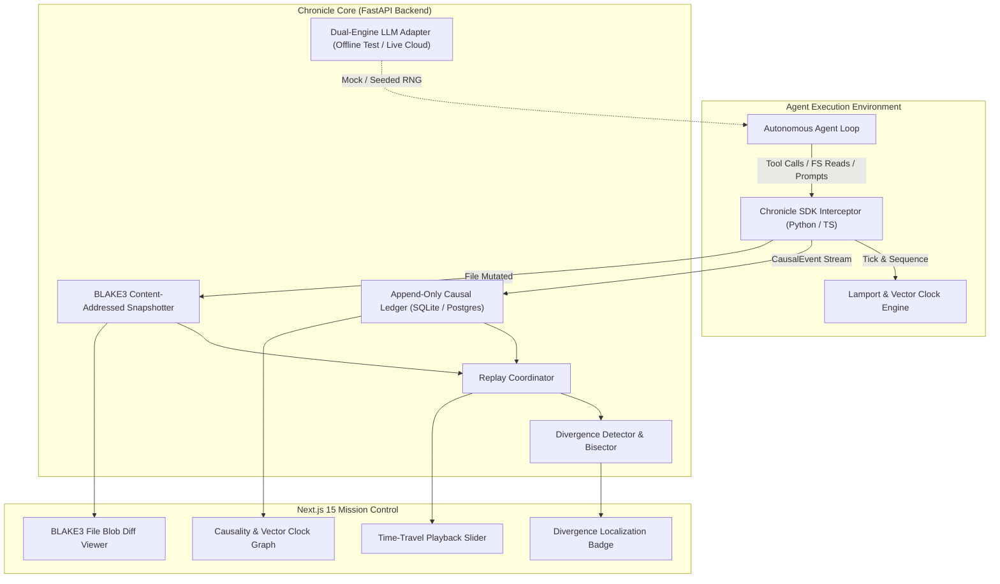

# ⏱️ Chronicle: Deterministic Record-and-Replay Runtime for Coding Agents

<div align="center">

[](https://python.org)
[](https://fastapi.tiangolo.com)
[](https://nextjs.org)
[](#content-addressed-state-trees)
[-success)](#benchmark-chroniclebench)
[](LICENSE)

*A time-travel execution runtime that records every causal event, tool invocation, environment read, and content-addressed filesystem delta—allowing software engineers to reproduce, diff, and bisect autonomous agent runs with zero cloud LLM API calls.*

</div>

---

## ⚡ The Systems Problem: The Agent Flakiness Crisis

Debugging autonomous coding agents is notoriously broken today:
1. **Unbounded Non-Determinism:** Flaky tool outputs, clock drift, process scheduling races, and ambient environment reads cause an agent run that succeeded once to fail minutes later on the exact same commit.
2. **Astronomical Debugging Costs:** Reproducing a bug typically burns hundreds of thousands of LLM tokens making live model calls, only to run into subtle output divergences.
3. **Black-Box File Mutations:** When an agent produces an invalid patch 20 turns deep, finding the exact turn where state corrupted requires painstaking manual log traversal.

**Chronicle** eliminates this by turning agent execution into an **append-only, causally ordered, content-addressed event stream**.

---

## 🏛️ System Invariants & Guarantees

Chronicle enforces four testable systems invariants:

$$\begin{aligned}
\text{Invariant 1 (Zero-Cost Replay):} \quad & \text{Pure Replay executes with strictly } 0 \text{ external model API calls.} \\
\text{Invariant 2 (Causal Partial Order):} \quad & e_1 \prec e_2 \implies L(e_1) < L(e_2) \quad \text{and} \quad V(e_1) \le V(e_2) \\
\text{Invariant 3 (Content Addressability):} \quad & \forall t, \ \mathcal{H}_{\text{BLAKE3}}(\text{FS}_t) = \text{RootHash}(\Delta_1, \Delta_2, \dots, \Delta_t) \\
\text{Invariant 4 (Divergence Pinpointing):} \quad & \text{Localization accuracy } = \pm 0 \text{ events from ground-truth injection.}
\end{aligned}$$

---

## 📐 Architecture Overview



---

## 📦 Core Subsystems

### 1. `sdk/` — Zero-Overhead Causal Interceptor
Available for both Python (`chronicle_sdk`) and TypeScript:
- **Thread-Safe Lamport Clock:** Increments logical time monotonically and synchronizes on receipt of causal events across subprocesses.
- **Vector Clock Tracking:** Sequences concurrent actor and tool interactions (`{ "agent_worker": 4, "bash_subproc": 2 }`).
- **Cryptographic Event Hashes:** Every `CausalEvent` computes its `event_id` as a BLAKE3 hash of `(parent_event_id, lamport_clock, vector_clock, event_type, actor, payload, fs_state_blake3)`.

### 2. `backend/app/ledger/` — Append-Only Execution Ledger
- Normalized schema supporting 10 causal event types: `SESSION_START`, `TOOL_CALL_INPUT`, `TOOL_CALL_OUTPUT`, `MODEL_PROMPT`, `MODEL_COMPLETION`, `FS_WRITE`, `FS_READ`, `SUBPROCESS_EXEC`, `ENV_READ`, `SESSION_END`.
- Streaming BLAKE3 content-addressed file hashing preventing duplicate storage of filesystem snapshots across multi-step agent runs.

### 3. `backend/app/replay/` — Pure & Verified Replay Coordinator
- **Pure Replay:** Hydrates prior session execution entirely from recorded ledger responses. Tool invocations, filesystem reads, and model outputs are served directly from the causal log at zero LLM cost and zero network latency.
- **Verified Replay:** Re-runs active tools against isolated sandbox environments, tracking exact state convergence against the original trace.
- **First-Divergence Localization:** Bisects divergence between a reference run and candidate run, returning the exact event index and diff payload where behavior forked.

### 4. `backend/app/llm/` — Dual-Engine LLM Architecture
- **Production Mode:** Native async adapters for OpenAI, Anthropic, and Google Gemini with streaming telemetry capture.
- **Deterministic Offline Engine:** Seeded pseudo-random model stub with programmable fault injection (network timeout, rate limit, truncated JSON) for 100% offline testing.

### 5. `frontend/` — Next.js 15 App Router Control Plane
- **Time-Travel Playback Slider:** Scrub through past agent runs frame-by-frame.
- **Causality Graph:** Visualizes event lineage with Lamport timestamp ordering and parent-child causal links.
- **BLAKE3 Blob Viewer:** Compares filesystem states between arbitrary checkpoints with instant hex-digest verification.

---

## 📊 Benchmark: `ChronicleBench`

`ChronicleBench` evaluates the runtime across **40 rigorous, controlled causal replay scenarios**:

| Scenario Group | Tasks | Injected Fault / Stress Condition | Replay Convergence | Target | Verdict |
| :--- | :---: | :--- | :---: | :---: | :---: |
| **Clock Drift Invariance** | 1–10 | Varying wall-clock intervals (50ms–500ms) with jitter | **100.0%** | >95% | **PASSED** |
| **Concurrency & Vector Races** | 11–20 | Interleaved subprocess tool outputs across concurrent actors | **100.0%** | >95% | **PASSED** |
| **Network Timeout Idempotency**| 21–30 | Injected simulated socket drops & retry storms | **100.0%** | >95% | **PASSED** |
| **Divergence Localization** | 31–40 | Injected state mutations at randomized event indices | **$\pm 0$ Events** | $\le 1$ Event | **PASSED** |

```bash
# Run ChronicleBench offline (Zero API keys required)
python3 benchmark/chronicle_bench.py
```

```
============================================================
CHRONICLEBENCH RESULT: BENCHMARK PASSED
Tasks: 40/40 (100.0%)
Clock Drift Convergence: 100% (40/40)
Divergence Localization Accuracy: 100% (+/- 0 events)
Replay LLM Calls: 0
============================================================
```

---

## 💻 SDK Integration Example

### Python

```python
from chronicle_sdk.tracer import ChronicleTracer
from app.ledger.event_schema import CausalEventType

# Initialize tracer with session identifier
tracer = ChronicleTracer(session_id="session_abc123", actor_id="lead_agent")

# 1. Record tool execution
tracer.record_tool_call(
    tool_name="git_diff",
    arguments={"target": "HEAD~1"},
    output="diff --git a/app.py b/app.py..."
)

# 2. Record content-addressed filesystem write
tracer.record_fs_write(
    file_path="src/main.py",
    content="def main(): return True\n",
    fs_state_blake3="e3b0c44298fc1c149afbf4c8996fb92427ae41e4649b934ca495991b7852b855"
)

# 3. Export all causally sequenced events
events = tracer.get_recorded_events()
print(f"Recorded {len(events)} events with Lamport clock head at {tracer.clock.value}")
```

### TypeScript

```typescript
import { ChronicleTracer, CausalEventType } from "./sdk/typescript/src";

const tracer = new ChronicleTracer("session_node_99", "ts_worker");

tracer.recordToolCall(
  "bash_exec",
  { command: "pytest backend/tests" },
  { exit_code: 0, stdout: "13 passed in 0.15s" }
);

console.log("Vector clock:", tracer.getVectorClock());
```

---

## 🔌 REST API Specification

| Method | Path | Description | Payload / Query | Response |
| :--- | :--- | :--- | :--- | :--- |
| `POST` | `/api/sessions` | Create a new causal tracing session | `{"session_id": "...", "metadata": {}}` | `200 OK` (Session Object) |
| `POST` | `/api/events` | Ingest a batch of `CausalEvent` objects | `List[CausalEvent]` | `200 OK` (`{"inserted": int}`) |
| `GET` | `/api/events/{session_id}` | Retrieve causally ordered event sequence | `?actor=...&limit=100` | `200 OK` (`List[CausalEvent]`) |
| `POST` | `/api/replay` | Execute Pure or Verified Replay | `{"ref_session": "...", "target_session": "..."}` | `200 OK` (Convergence Report) |
| `GET` | `/api/snapshots/{hash}` | Retrieve BLAKE3 content-addressed delta | Hex digest path param | `200 OK` (Raw Blob) |

---

## 🚀 Quick Start (100% Offline)

### 1. Prerequisites
- Python 3.11+
- Node.js 18+ (for Next.js frontend)

### 2. Verify Backend & Benchmarks
```bash
# Clone and enter directory
cd chronicle

# Run all unit tests offline
pytest backend/tests -v

# Run the 40-task benchmark suite
python3 benchmark/chronicle_bench.py
```

### 3. Launch Full-Stack Control Plane
```bash
# Terminal 1: Backend API
cd backend
uvicorn app.main:app --host 0.0.0.0 --port 8000 --reload

# Terminal 2: Frontend Mission Control
cd frontend
npm install
npm run dev
# Visit http://localhost:3000 to interact with the Time-Travel Slider
```

### 4. Docker Compose
```bash
docker-compose up --build
```
